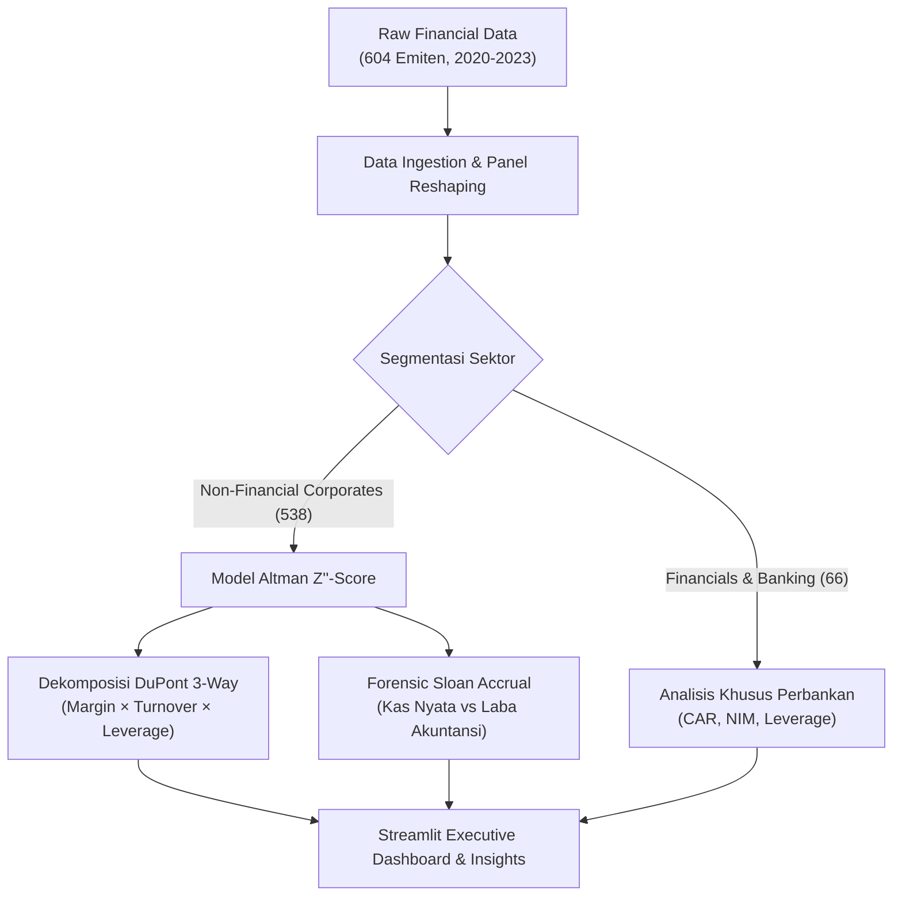

# 📊 Analisis Komprehensif Kesehatan Keuangan 604 Emiten BEI (2020–2023)
### *Exploratory Data Analysis, Distress Diagnostics, & Interactive Decision Support Dashboard*

[](https://www.python.org/)
[](https://streamlit.io/)
[](https://altair-viz.github.io/)
[](https://pandas.pydata.org/)
[](#)

---

## 📌 Ringkasan Proyek

Proyek ini menghadirkan analisis komprehensif terhadap kinerja keuangan, struktur modal, risiko kebangkrutan, dan kualitas laba dari **604 perusahaan publik yang tercatat di Bursa Efek Indonesia (BEI / IDX)** sepanjang periode **2020 hingga 2023** (mencakup masa krisis pandemi, *commodity boom*, hingga fase normalisasi suku bunga).

Proyek terdiri dari dua komponen utama:
1. **Interactive Exploratory Data Analysis (EDA) Notebook (`IDX_Financial_Project.ipynb`)**: Pemodelan panel longitudinal, rekayasa rasio keuangan tingkat lanjut, dan visualisasi interaktif Altair.
2. **Enterprise Decision Support Dashboard (`app.py`)**: Aplikasi web interaktif berbasis Streamlit yang dilengkapi kartu KPI eksekutif, filter dinamis, visualisasi multi-tab, serta fitur *drill-down* profil emiten perorangan dan ekspor data CSV.

---

## 🔬 Kerangka Analisis & Metodologi

Proyek ini menggunakan empat kerangka kerja analitik akuntansi dan keuangan korporasi:



### 1. Pemisahan Sektor Finansial vs Non-Finansial
Institusi perbankan (66 emiten, seperti BBCA, BBRI, BMRI, BBNI) memiliki model bisnis menghimpun dana pihak ketiga sebagai liabilitas operasional, sehingga tidak menyajikan modal kerja konvensional (*Working Capital*). Proyek ini memisahkan kedua kelompok secara otomatis guna mencegah bias dan distorsi metrik solvabilitas.

### 2. Dekomposisi Profitabilitas DuPont (3-Way)
Membedah sumber penggerak *Return on Equity* (ROE) ke dalam tiga pilar efisiensi:
$$\text{ROE} = \left(\frac{\text{Laba Bersih}}{\text{Pendapatan}}\right) \times \left(\frac{\text{Pendapatan}}{\text{Total Aset}}\right) \times \left(\frac{\text{Total Aset}}{\text{Ekuitas}}\right)$$
* **Efisiensi Operasional (Margin Laba Bersih)**
* **Produktivitas Aset (*Asset Turnover*)**
* **Pengungkit Keuangan (*Equity Multiplier / Financial Leverage*)**

### 3. Model Solvabilitas Altman Z''-Score (Emerging Markets)
Memetakan risiko gagal bayar dan kebangkrutan untuk emiten non-finansial ke dalam 3 zona:
$$Z'' = 6.56 X_1 + 3.26 X_2 + 6.72 X_3 + 1.05 X_4$$
* **Safe Zone ($Z'' > 2.60$):** Neraca keuangan sehat, risiko gagal bayar rendah.
* **Grey Zone ($1.10 \le Z'' \le 2.60$):** Perlu kehati-hatian dan pengawasan efisiensi.
* **Distress Zone ($Z'' < 1.10$):** Beban utang berlebih, berisiko tinggi menghadapi krisis likuiditas.

### 4. Forensic Sloan Accruals (Kualitas Laba)
Menguji apakah laba bersih yang dilaporkan didukung oleh kas masuk nyata dari operasional atau didorong oleh akrual piutang agresif (*paper profit*):
$$\text{Accrual Ratio} = \frac{\text{Laba Bersih} - \text{Arus Kas Operasi (CFO)}}{\text{Total Aset}}$$

---

## 📈 Temuan Kunci (Key Insights)

1. **Tren Pemulihan Pasca-Pandemi (2020–2023):**
   * **2020:** Masa krisis terberat dengan median Altman Z berada pada level rawan (**2.65**) dan 29.9% emiten berada di *Distress Zone*.
   * **2021–2022:** Ledakan komoditas (*coal*, *nickel*, CPO) melipatgandakan pendapatan agregat dan arus kas operasi, mendorong median ROE ke puncaknya di **7.38%** (2022).
   * **2023:** Korporasi BEI melakukan *deleveraging* agresif untuk mengantisipasi kenaikan suku bunga acuan, menaikkan median Altman Z ke rekor tertinggi (**3.71**).
2. **Lonjakan Emiten Sehat (Safe Zone):**
   * Porsi emiten di **Safe Zone** meningkat pesat dari **49.8% (2020)** menjadi **63.3% (2023)**.
   * Emiten di **Distress Zone** berhasil ditekan dari **29.9%** ke **23.6%**.
3. **Peta Strategi Bisnis (Kuadran DuPont):**
   * **Quality Compounders (Kuadran 1):** Margin tebal ($>10\%$) dan perputaran aset cepat ($>1.0\times$) didominasi emiten barang konsumsi unggulan dan eksportir komoditas efisien.
   * **Volume Drivers (Kuadran 2):** Margin tipis namun perputaran barang sangat cepat (cth. ritel AMRT).
   * **Margin Specialists (Kuadran 3):** Siklus aset padat modal dengan margin tinggi (cth. telekomunikasi TLKM).
   * **Distressed (Kuadran 4):** Margin negatif dan perputaran rendah, terkonsentrasi pada emiten dengan risiko utang tinggi.

---

## 📁 Struktur Direktori

```text
Project-SOKO-FINANCIAL/
├── IDX_Financial_Project.ipynb     # Notebook EDA lengkap & visualisasi Altair
├── app.py                          # Aplikasi Streamlit Intelligence Dashboard
├── combined_financial_data_idx.csv # Dataset historis keuangan 604 emiten (2020-2023)
├── archive.zip                     # Arsip dataset sumber
└── README.md                       # Dokumentasi resmi proyek
```

---

## 🚀 Panduan Instalasi & Penggunaan

### 1. Prasyarat Sistem
* Python 3.9 atau versi yang lebih baru
* Package manager `pip`

### 2. Kloning / Unduh Repositori
```bash
git clone https://github.com/Bimzt/Project-SOKO-FINANCIAL.git
cd Project-SOKO-FINANCIAL
```

### 3. Instalasi Pustaka Dependensi
Pasang seluruh dependensi yang dibutuhkan:
```bash
pip install pandas numpy altair streamlit jupyter nbformat
```

### 4. Menjalankan Jupyter Notebook
Untuk membaca dan menjalankan analisis eksploratif:
```bash
jupyter notebook IDX_Financial_Project.ipynb
```

### 5. Menjalankan Dashboard Streamlit
Untuk membuka dashboard analitik interaktif:
```bash
streamlit run app.py
```
Aplikasi akan otomatis terbuka pada browser Anda di alamat: `http://localhost:8501`.

---

## 🖥️ Fitur Dashboard Streamlit (`app.py`)

* **Executive KPI Cards:** Ringkasan pendapatan agregat, laba bersih, median ROE, porsi *Safe Zone*, dan median Altman Z.
* **Filter Dinamis:** Pemilihan Tahun Fiskal (2020–2023), Segmentasi Sektor (Non-Finansial vs Bank), dan Ambang Batas Solvabilitas.
* **6 Modul Tab Komprehensif:**
  1. `🌐 Trajektori Makro (2020-2023)`: Grafik multi-line pendapatan, kas, dan laba.
  2. `🎯 Matriks Profitabilitas DuPont`: Scatter plot kuadran interaktif dengan tooltip rasio keuangan.
  3. `🛡️ Solvabilitas & Altman Z''-Score`: Diagram batang stacked distribusi zona kebangkrutan tahunan.
  4. `🔍 Forensic Earnings Quality (Sloan)`: Uji paritas laba kas vs laba kertas akrual.
  5. `🏢 Single-Company Drill-Down`: Kartu skor profil keuangan mendalam untuk emiten perorangan.
  6. `📋 Master Data Explorer`: Tabel data interaktif dengan pencarian dan tombol unduh CSV.

---

## 💡 Rekomendasi Bisnis & Investasi

1. **Alokasi Modal pada 'Quality Compounders':** Prioritaskan portofolio pada emiten yang terbukti menjaga margin tinggi dan perputaran aset stabil di tengah fluktuasi inflasi.
2. **Mitigasi 23.6% Emiten Distress:** Lakukan restrukturisasi atau penataan ulang utang pada emiten yang masih berada di zona bahaya sebelum terjadi pengetatan likuiditas.
3. **Penyaringan Kualitas Laba:** Hindari emiten yang hanya mencatatkan kenaikan laba di atas kertas tanpa diimbangi peningkatan arus kas operasional riil.
4. **Pendekatan Khusus Sektor Finansial:** Evaluasi saham perbankan melalui rasio permodalan (CAR), margin bunga bersih (NIM), dan kredit bermasalah (NPL), bukan rasio modal kerja umum.
5. **Efisiensi Siklus Kas:** Percepat penagihan tagihan piutang dan optimalkan persediaan (*lean inventory*) agar menjaga cadangan kas tunai tanpa bergantung pada utang baru.

---

## 🛠️ Teknologi yang Digunakan

* **Bahasa Pemrograman:** Python
* **Pengolahan & Reshaping Data:** Pandas, NumPy
* **Visualisasi Data Interaktif:** Altair (Vega-Lite Grammar)
* **Frontend Dashboard:** Streamlit
* **Lingkungan Analisis:** Jupyter Notebook